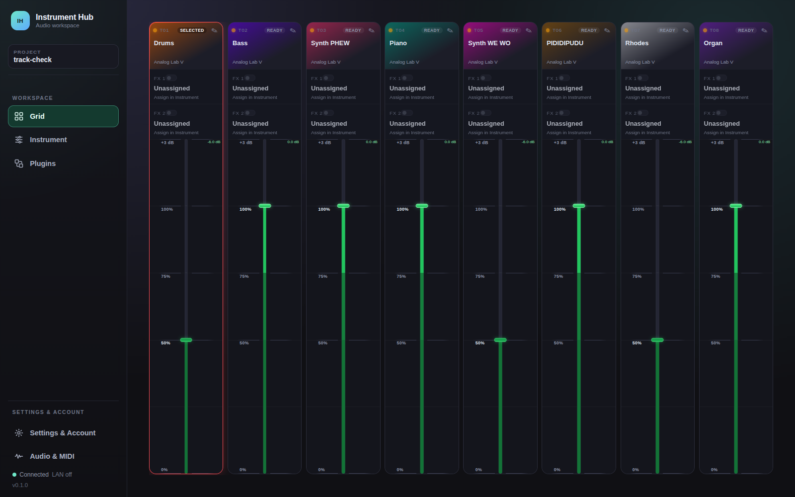

# Instrument Hub

**A live-performance workspace for VST3 instruments, effects and the Novation Launchpad Mini MK3.**

Instrument Hub combines a JUCE 8 / C++20 audio engine with an embedded React
interface. Eight prepared tracks stay warm, the Launchpad switches between
them instantly, and the same control API drives the desktop UI and a tablet
remote.



## Highlights

- **Eight-track performance grid** — each track owns an instrument, an
  arbitrary FX chain, two assignable "hot" FX, and a five-step mixer fader.
  All eight sources are prepared at project open, so switching is a short gain
  ramp rather than a plugin load.
- **Low-latency engine** — fixed audio graph, no allocation, locks or logging
  in the audio callback, protected warm slots, 2–5 ms equal-power switching.
- **Launchpad Mini MK3** — programmer-mode LEDs, eight track pads, hot-FX
  toggles, volume steps and a controller-following selection. Generic MIDI
  keyboards and controllers are supported too.
- **VST3 hosting** — out-of-process scanning and page-scoped plugin hosting,
  per-patch state capture, editor windows, and automatic recovery when a
  plugin host dies.
- **Built-in sound** — sampler (WAV/AIFF/FLAC, velocity layers, round-robin,
  choke groups), audio-input tracks, and EQ, compressor, delay and reverb
  inserts.
- **Projects that survive restarts** — versioned `.ihub` containers,
  autosave, recent projects, and per-patch plugin state.
- **Audio & MIDI setup** — ALSA, JACK and PipeWire device selection, latency
  measurement, xrun counts, a "Test & recommend" buffer-size wizard, and
  per-interface profiles.
- **Local HTTP + WebSocket API** — the desktop UI and tablet remote share one
  contract, with optional token pairing and LAN mode.
- **Legacy 64-patch sets** still open with the original 8×8 family grid.

## Download

Linux x86_64 builds are published on the
[releases page](https://github.com/MatijaKocevar/instrument-hub/releases).

```bash
chmod +x Instrument-Hub-0.1.0-x86_64.AppImage
./Instrument-Hub-0.1.0-x86_64.AppImage
```

The AppImage is self-contained for the engine, but it uses the system WebKit
and audio stack:

- WebKitGTK 4.1 (`libwebkit2gtk-4.1-0`)
- a glibc distribution with glibc 2.39 or newer (Ubuntu 24.04 is the verified
  baseline)
- ALSA, and optionally JACK/PipeWire for the low-latency path

The build is **unsigned**. Download it from the release page and verify it
against the published `SHA256SUMS`:

```bash
sha256sum --check SHA256SUMS
```

Windows and macOS packages are not part of the 0.1.0 release. The source
builds for those platforms are not validated yet.

## First launch

1. Start the app. On a fresh machine it creates an eight-track blank project
   in `~/Music/Instrument Hub/Untitled.ihub`.
2. Open **Audio & MIDI**, select your interface and buffer size. On
   PipeWire/JACK, put the card in its `pro-audio` profile first and select the
   `… Pro` device. **Test & recommend** probes 64, 96 and 128 frames and
   stores the best stable setting for that interface.
3. Open a track from the Grid, choose **Change source**, and load a VST3,
   sampler kit or live audio input.
4. Connect the Launchpad Mini MK3. Its `MI` port is detected automatically;
   the top row is the track selector, the two rows below toggle the hot FX,
   and the bottom five rows set the volume step.
5. Save the project from the footer. Autosave keeps the current `.ihub` up to
   date after each edit.

The default mapping is the track layout in
[`shared/tracks-set.yaml`](shared/tracks-set.yaml). The protocol reference is
[`docs/launchpad-mini-mk3.md`](docs/launchpad-mini-mk3.md).

## Build from source (Linux)

Prerequisites:

- CMake ≥ 3.22, Ninja, a C++20 compiler
- Node.js ≥ 22.13 and pnpm 11 (the repository pins pnpm via `packageManager`;
  `corepack pnpm` works)
- ALSA, JACK, freetype, X11, GL and WebKitGTK 4.1 development headers

On Ubuntu 24.04:

```bash
sudo apt install build-essential pkg-config cmake ninja-build \
  libasound2-dev libjack-jackd2-dev libfreetype-dev libx11-dev \
  libxcomposite-dev libxcursor-dev libxext-dev libxinerama-dev \
  libxrandr-dev libxrender-dev libwebkit2gtk-4.1-dev \
  libglu1-mesa-dev libcurl4-openssl-dev
```

Clone and build:

```bash
git clone --recursive https://github.com/MatijaKocevar/instrument-hub.git
cd instrument-hub
corepack pnpm --dir ui install --frozen-lockfile
corepack pnpm --dir ui run build
cmake --preset release
cmake --build --preset release --parallel \
  --target instrument-hub ihub-scanner ihub-sandbox
```

Run:

```bash
./build-release/engine/instrument-hub
```

Useful modes:

```bash
./build-release/engine/instrument-hub --serve          # headless API
./build-release/engine/instrument-hub --no-audio       # UI/API without a device
./build-release/engine/instrument-hub --list-devices   # enumerate audio devices
./build-release/engine/instrument-hub --diagnostics    # device/plugin/log report
```

The mapping is loaded from the open `.ihub` project. Set
`INSTRUMENT_HUB_SET=/path/to/set.yaml` to override it for development.

More detail:

- [docs/audio-setup.md](docs/audio-setup.md) — the audio wizard and Linux
  pro-audio path
- [docs/plugin-instances.md](docs/plugin-instances.md) — plugin hosts,
  editors and recovery
- [docs/architecture.md](docs/architecture.md) — the module map and the four
  call paths

## Control API

The engine serves `127.0.0.1:8080` by default:

- `GET /state` — tracks, armed slot, mixer, transport and project state
- `POST /tracks/{index}/select`, `/fx/{hot}/toggle`, `/volume`
- `PATCH /patches/{slot}`, `POST /patches/{slot}/source`, `/fx`
- `GET/POST /audio`, `POST /audio/measure`
- `GET /plugins`, `POST /plugins/rescan`
- `GET /midi`, `POST /midi/inputs`, `POST /midi/pad-test`
- `GET/POST /project` — new, open, save, save-as, close
- `GET /meters` and `GET /events` — WebSocket streams
- `GET/POST /pairing`, `POST /pair` — tablet pairing and LAN mode

The full contract is [`shared/api/openapi.yaml`](shared/api/openapi.yaml). The
UI's TypeScript client is generated from it during `pnpm run build`.

## Project layout

```text
engine/       JUCE engine, audio graph, plugin hosts, control API
ui/           React + TypeScript UI embedded into the app
shared/       OpenAPI document, set schema and starter templates
docs/         audio, controller, plugin and architecture guides
scripts/      build, run, bootstrap and packaging helpers
```

The audio-thread contract is simple and enforced by `RtGuard`: no allocation,
locks, logging or file I/O in the callback. See [AGENTS.md](AGENTS.md) and
[plan/DECISIONS.md](plan/DECISIONS.md) before changing the engine.

## Status and limitations

- **Linux x86_64 is the only published platform for 0.1.0.** Windows and
  macOS packaging are deferred.
- The AppImage is **unsigned**; there is no notarisation or code signing.
- A physical Launchpad, a real audio interface, a tablet remote and
  third-party plugins still need validation on the target machine; the open
  items are tracked in [plan/BLOCKERS.md](plan/BLOCKERS.md).
- VST3 plugins are not bundled. You must own and license any third-party
  instrument or effect you load.
- A crashed plugin host is isolated, but a shared page host failure takes that
  instrument page down until it recovers.

## License

Instrument Hub is licensed under the **GNU Affero General Public License v3.0**
(AGPL-3.0). See [LICENSE](LICENSE).

The engine uses [JUCE 8](https://juce.com/), which is dual-licensed under
AGPLv3 or a commercial JUCE licence. This project uses the AGPLv3 option, so
the complete corresponding source is this repository. If you need to
distribute a closed-source build, obtain a commercial JUCE licence first.

Third-party notices are in [THIRD_PARTY_NOTICES.md](THIRD_PARTY_NOTICES.md).
The `.ihub` project format, the engine and the UI are original work; JUCE,
cpp-httplib, React, Vite and their dependencies remain under their own
licences.
